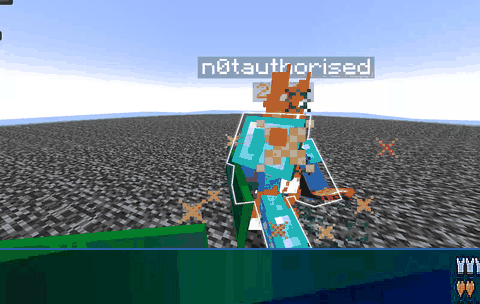
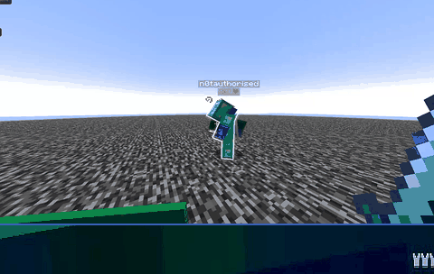
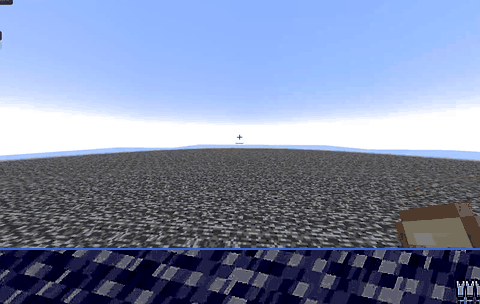
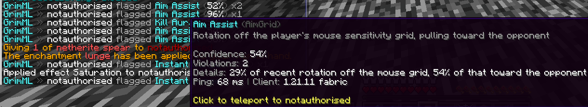
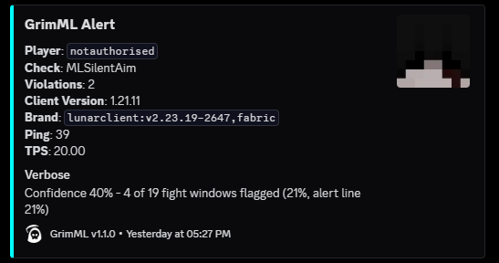

# GrimML

[](https://github.com/vanillaxtra/grimml/actions/workflows/build.yml)
[](https://github.com/vanillaxtra/grimml/releases)
[](https://papermc.io/)
[](https://adoptium.net/)
[](https://github.com/GrimAnticheat/Grim)
[](https://bstats.org/plugin/bukkit/grim-ml/35441)
[](#beta-read-this)

Machine-learning combat checks for **[Grim Anticheat](https://github.com/GrimAnticheat/Grim)**. GrimML catches the
combat cheats using machine learning models struggle with: **Kill Aura, Aim Assist, Triggerbot, Silent Aim, Instant Lunge and Auto
Shield Breaker**.

# 🧠 What It Detects

### ML checks (trained models)

Every 2 seconds GrimML scores each fighting player's last 8 seconds of aim and clicks with a trained model. A fight
is flagged only when enough of it looks like cheating, so one lucky flick never flags anyone.

| Check | Catches |
|-------|---------|
| **Kill Aura** | Automatic attacking and aiming at whoever is in reach |
| **Aim Assist** | Rotation pulled toward the opponent, even when smoothed and randomized |
| **Triggerbot** | Attacks fired the moment the crosshair is on a target |
| **Silent Aim** | Server-side aim that differs from what the player sees |

<!-- GIF: killaura - a Kill Aura player getting flagged, chat alert visible -->


<!-- GIF: aimassist - aim assist on a strafing opponent, alert appears -->


### Rule checks (no model, exact)

| Check | Catches |
|-------|---------|
| **Aim Assist (AimGrid)** | Mouse rotation that is not a whole number of sensitivity steps and leans toward the opponent |
| **Instant Lunge** | Spear swap, jab and swap back faster or more exactly than a hand can |
| **Swap Macro** | A hotbar swap after an attack in the same client tick, which the vanilla client never sends |
| **Shield Breaker** | Swapping away from the axe exactly one tick after breaking a shield, every time |

<!-- GIF: lunge - Instant Lunge macro getting flagged -->


---

# 🔔 Alerts

* **One short line** – `GrimML » Steve flagged Kill Aura (74%) x2`
* **Confidence %** – how sure the check is, readable by anyone.
* **Hover for details** – check, description, violations, what was measured, ping and client.
* **Click to teleport** – runs `/tp %player%` by default (any command).
* **Sound ping** – for staff with `grimml.alerts.sound`.
* **Toggle** – `/grimml alerts` turns your own alerts on or off.
* **Grim-friendly** – fires Grim's `FlagEvent`, so other Grim add-ons see and can cancel GrimML flags.
* **Missed alerts on join** – staff who log in see what was flagged while they were away, one line per player and
  check. Click a line to open that player's history.
* **History** – every alert and punishment is saved for 14 days (`plugins/GrimML/history/`).
  `/grimml history <player> [days]` shows them, for offline players too and after restarts.

# 👁️ Staff Overlay

`/grimml overlay` puts a small hologram on flagged players' heads that only you can see:

* **Red** – checks they were flagged for in the last few minutes: `Kill Aura 74% 12/30` (confidence, then flagged
  windows out of the fight's windows; rule checks show how often: `Swap Macro 100% x2`).
* **Yellow** – a fight in progress with flagged windows that has not alerted yet.
* It **rides on their head** in your client only (no server entity), so it moves smoothly with them, never teleports
  on its own and never gets in the way of `/tp`, pearls or other plugins.

<!-- GIF: alerts - hovering over an alert, then clicking it to teleport -->


---

# 💬 Discord Webhook

* Laid out **exactly like Grim's own webhook**, so GrimML alerts sit neatly next to Grim's.
* Uses **Grim's webhook URL** automatically, or set your own.
* **Punishments are posted too** – a red *GrimML Punishment* embed with the player, the punishment and the commands
  that ran (kicks, bans, anything).

<!-- IMAGE: webhook - an alert embed and a punishment embed in Discord -->


---

# ⚖️ Punishments

Run any console commands when a player reaches a number of violations. Group checks together, pick your own counts,
use your own ban plugin. **Off by default.**

```yaml
punishments:
  enabled: true
  groups:
    instant-lunge:
      checks: [Instant Lunge, Swap Macro]
      at-violations:
        3:
          - "kick %player% Unfair advantage (%check%)"
        6:
          - "ban %player% Unfair advantage (%check%)"
```

* **Groups** – each group adds up its checks' violations (check names, short names like `Instant Lunge`, or `*`).
* **Any commands** – kick, tempban, a Discord bot command, a broadcast… as many as you like per count.
* **Decay** – violations fade over time (per group), and **relogging does not reset them**.
* **Random delay** – each punishment waits a random 10–45 s (`punishments.delay-seconds`), so a cheater can't tell
  which hit caught them. It still runs if they log off.
* **Webhook** – every punishment is posted to Discord.
* `/grimml status <player>` shows a player's counts.

---

# 🔄 Always Up To Date

* **Models update by themselves** – new models are downloaded from this repository, checked (sha256) and swapped in
  **without a restart**. A broken download keeps the old models running.
* **Plugin update checker** – the console and staff with `grimml.update.notify` are told when a new release is out
  (once a day, with a download link).

---

# 🚀 Built For Performance

* Packet data is copied on Netty threads into small per-player buffers.
* All scoring runs on **one background thread**. The main thread only sends chat and runs commands.
* Floodgate (Bedrock), creative and spectator players are skipped.

---

## Commands

| Command | Permission | Description |
|---------|------------|-------------|
| `/grimml alerts` | `grimml.alerts` | Turn your alerts on or off |
| `/grimml overlay` | `grimml.overlay` | Show flagged checks above players' heads (only to you) |
| `/grimml history <player> [days]` | `grimml.history` | A player's past alerts and punishments |
| `/grimml status [player]` | `grimml.admin` | Models, checks, punishments, and a player's scan state and counts |
| `/grimml update` | `grimml.admin` | Download newer models now |
| `/grimml reload` | `grimml.admin` | Reload `config.yml` |
| `/grimml telemetry` | `grimml.admin` | Telemetry status, and send what is waiting now |
| `/grimml label <player> cheat\|legit [kind]` | `grimml.label` | Tell telemetry what a player is, for training |

**Alias:** `/gml`

---

## Permissions

| Permission | Default | Description |
|------------|---------|-------------|
| `grimml.*` | OP | Everything below except bypass |
| `grimml.alerts` | OP | See alerts in chat |
| `grimml.alerts.sound` | OP | Hear a ping with every alert |
| `grimml.overlay` | OP | Use `/grimml overlay` |
| `grimml.history` | OP | Use `/grimml history` |
| `grimml.notify` | OP | Be told once when new models are downloaded (on next join if offline) |
| `grimml.update.notify` | OP | Be told when a new GrimML release is out |
| `grimml.admin` | OP | Status, reload, update |
| `grimml.bypass` | false | Never scanned by any check |
| `grimml.label` | OP | Use `/grimml label` |
| `grimml.telemetry.trusted` | false | Telemetry sends this player's fights labelled legit (staff, known clean players) |
| `grimml.bypass.telemetry` | false | Never included in telemetry uploads |
| `grimml.bypass.<check>` | false | Never flagged by one check (`mlkillaura`, `mlaimassist`, `mltriggerbot`, `mlsilentaim`, `aimgrid`, `lungerate`, `lungehold`, `swaporder`, `axehold`, `stunrepeat`, `slamrepeat`, `webrepeat`) |

---

## Placeholders

Used in alerts, hover, click command, webhook and punishments.

| Placeholder | Description |
|-------------|-------------|
| `%player%` / `%uuid%` | Player name / UUID |
| `%check%` | Short name, e.g. `Kill Aura` |
| `%check_name%` | Internal name, e.g. `MLKillAura` |
| `%description%` | What the check looks for |
| `%confidence%` | 0–100 |
| `%vl%` / `%violations%` | Violations of this check |
| `%verbose%` | What was measured |
| `%ping%` / `%version%` / `%brand%` | Ping, client version, client brand |
| `%tps%` / `%grimml_version%` | Server TPS, GrimML version |
| `%group%` / `%group_vl%` | Punishments only: group name and its violations |
| `%commands%` | Punishment webhook only: the commands that ran |

---

## Configuration

Main config: `plugins/GrimML/config.yml`

- `alerts` – Format, hover, click command, sound, decay
- `history` – How many days of alerts to keep, and the missed-alerts message on join
- `overlay` – Staff overlay height, size, lines and MiniMessage formats
- `webhook` – Discord embed, and `webhook.punishments` for the punishment embed
- `punishments` – Groups, checks, commands per violation count, random delay
- `aim-grid`, `lunge-rate`, `lunge-hold`, `swap-order`, `axe-hold`, `combo-repeat` – Rule check tuning
- `models` – Auto-update and manifest URL
- `update-checker` – Plugin release notices
- `telemetry` – Opt-in anonymous fight data upload (see below)

Full technical details: [detector/README.md](detector/README.md).

### Telemetry (opt-in)

Off by default. With `telemetry.enabled: true` GrimML uploads, every `upload-every-minutes` (60), a sample of the
fights it scored (each window's model features and scores) and the alerts, gzipped, to the GrimML receiver. This is
used to check and retrain the models on more players.

**Which fights are sent** (fixed, the same on every server). A fight is one player's scored windows with no gap over 30 s. It
waits 5 minutes after it ends (so a late alert or a label still reaches it), then gets a band:

| Band | When | Sent |
|------|------|------|
| high | an alert came during it | all |
| unsure | at least 25% of its windows passed a model's threshold, no alert | all |
| low | the rest | about as many as high + unsure together |

3% of all fights are also sent whatever their band, as an unbiased sample. Each fight line says its band and the
chance it had of being sent (`keep`), so training can weight it back to the real mix. A player sends at most 6
fights an hour.

**Labels.** Scores are the model's guess, not the truth, so training needs labels:
- `/grimml label <player> cheat [kind]` or `legit`: when staff are sure (caught on video, admitted, reviewed). Their
  fights from the last 5 minutes and the next 30 are sent with the label.
- `grimml.telemetry.trusted` (give it to staff or known clean players): their fights are sent labelled legit.

- **Never sent:** player names, UUIDs, IPs, chat, coordinates. A player is a salted hash that only your server can
  make, so the same player on two servers can't be matched. Your server is a random id in
  `plugins/GrimML/telemetry/` (delete that folder for a new one).
- At most 48 MB waits in memory (oldest dropped). If the receiver is down or full, uploads wait and retry.
- `/grimml telemetry` shows what is waiting and sends it now. `grimml.bypass.telemetry` leaves a player out.
- Running your own receiver: [tools/receiver/README.md](tools/receiver/README.md).

---

## Beta: read this

The models are trained on a small number of players and recorded fights, so **they can flag legit players**,
especially very good ones. Use the alerts to decide who to watch and spectate; keep punishments for the ML checks
off (or high) until the alerts look right on your own server. The rule checks (Instant Lunge, Swap Macro) never
flagged a legit player in testing.

Found a false flag? Open an issue with the alert (hover text or webhook embed).

---

## For developers

This repository also holds the tools used to build the models:

| Folder | What |
|--------|------|
| `detector/` | The GrimML plugin ([technical README](detector/README.md)) |
| `recorder/` | **grimmlrecorder**, records labelled combat data for training ([README](recorder/README.md)) |
| `training/` | Python: decode, features, train, publish |
| `models/` | The published models GrimML downloads |

`mvn clean package` in the root builds both plugins and checks the Java scoring against Python.

---

## Statistics

[](https://bstats.org/plugin/bukkit/grim-ml/34985)

---

## Changelog

See [CHANGELOG.md](CHANGELOG.md) for what changed in each release.

---

## License

- **Source code:** [MIT](LICENSE).
- **Trained models** (`models/`, the copies inside the jar and the ones served by auto-update):
  [GrimML Model License](models/LICENSE.md). Free to run on any server through the official GrimML plugin.
  **No paid use, no copying them into other repositories, plugins or services, and no retraining or building other
  models from them.**
