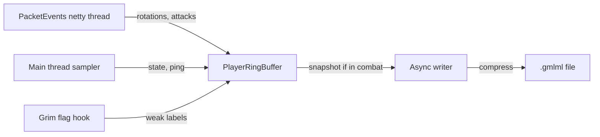

# grimml

   

A Paper plugin that records anonymized PvP combat data next to [Grim Anticheat](https://github.com/GrimAnticheat/Grim), to build a dataset for machine-learning cheat detection.

## Why

Rule-based anticheats like Grim are good at catching movement and protocol cheats. Combat cheats such as aim assist and subtle killaura are harder to pin down with fixed rules. A model trained on real fights could catch them, but that first needs clean, labelled combat data. grimml collects that data on a live server without hurting performance.

**This is Phase 1: recorder only.** It does no detection, no ML inference and no punishments. It writes combat windows to disk, and that's all.

## Features

- **Combat-only recording.** A rolling pre-buffer (5s by default) and a post-buffer (2s) are kept per player, and a window is only saved around attacks.
- **Captures:** yaw/pitch from rotation packets, attack packets, sprint/sneak/vehicle/elytra state, ping, client brand and protocol, and whether the player is on Bedrock (via Geyser/Floodgate).
- **Weak labels from Grim:** when GrimAC is installed, its flags are stored in the same window.
- **Anonymized:** player UUIDs are hashed with SHA-256 and a salt, and session ids are random per login. Raw UUIDs never reach disk.
- **Built not to lag the server:** the packet path neither allocates nor locks. A single async writer uses a bounded queue and drops the newest windows instead of blocking.
- **Safety valves:** recording auto-pauses on high MSPT, auto-pauses over a disk cap, and can be paused by hand.

## Requirements

| | |
|---|---|
| Server | Paper (or a fork such as Leaf), 1.21.1 through 26.x |
| Java | 21+ |
| Required plugin | [PacketEvents](https://github.com/retrooper/packetevents) 2.14.0+ |
| Optional plugins | GrimAC (flag labels), Geyser-Spigot / floodgate (Bedrock flag) |

## Installation

There are no release builds yet, so build it yourself (needs JDK 21+ and Maven):

```bash
git clone https://github.com/vanillaxtra/grimml
cd grimml
mvn clean package -DskipTests
```

1. Copy `target/grimml-0.1.0-SNAPSHOT.jar` and PacketEvents into `plugins/`.
2. Start the server once to generate `plugins/grimml/config.yml`.
3. **Change `anonymize-salt`** to a random secret value, then run `/grimml reload` or restart.

Recordings are written to `plugins/grimml/recordings/`.

## Usage

All commands need `grimml.admin` (op by default).

| Command | What it does |
|---|---|
| `/grimml status` | enabled/paused state, windows written and dropped, bytes written |
| `/grimml pause` | stop saving new windows |
| `/grimml resume` | resume saving |
| `/grimml reload` | reload `config.yml` |

## Configuration

| Key | Default | Meaning |
|---|---|---|
| `enabled` | `true` | master switch |
| `anonymize-salt` | `change-me` | salt for player id hashing; set your own and don't reuse it across public datasets |
| `pre-combat-seconds` | `5` | history kept before an attack |
| `post-combat-seconds` | `2` | time recorded after the last attack |
| `writer-interval-ms` | `2000` | how often the writer flushes to disk |
| `writer-queue-capacity` | `256` | queued windows before new ones are dropped |
| `ring-capacity` | `128` | rotation samples kept per player |
| `event-ring-capacity` | `64` | attack/state/flag events kept per player |
| `mspt-pause-threshold` | `50.0` | auto-pause above this MSPT (`0` disables); resumes below 80% of it |
| `safety-check-interval-ms` | `5000` | how often state is sampled and the safety checks run |
| `max-disk-mb` | `10240` | auto-pause once recordings exceed this size (`0` = unlimited) |
| `recordings-dir` | `recordings` | output folder, relative to the plugin folder |

## Output format

Each combat window becomes one file: `<date>_<anonId>_<session>_<rand>.gmlml`.

- **Header:** magic `GML1`, schema version, session id, anonymized player id, window start/end (nanos), state flags, ping, client protocol, client brand.
- **Body:** a Deflate-compressed list of records:

| Type | Id | Fields |
|---|---|---|
| ROTATION | 1 | tick, yaw, pitch, nanos |
| ATTACK | 2 | tick, nanos, target entity id, reserved, ping |
| STATE | 3 | tick, nanos, flags (sprint, sneak, vehicle, elytra, bedrock), ping |
| GRIM_FLAG | 4 | tick, nanos, check name hash (FNV-1a), ping |

The encoder lives in `format/BinaryFormat.java`, and `format/BinaryFormatSelfCheck.java` is a working decoder example.

## How it works



More detail is in [docs/architecture.md](docs/architecture.md) and [docs/decisions.md](docs/decisions.md).

## Non-goals (Phase 1)

- No detection, alerts or punishments.
- No hit-offset calculation; that is left to offline feature extraction.
- No Folia support yet.

Open items are tracked in [docs/known-issues.md](docs/known-issues.md).

## Contributing

```bash
mvn clean package -DskipTests   # build
mvn exec:java                   # run the binary format self-check
```

- One folder per function and one file per feature (for example `commands/StatusCommand.java`).
- Keep the packet path free of allocations and locks.
- Comments are single-line and lowercase, and only explain what the code can't.
- Update `docs/` when behaviour changes.

## License

[MIT](LICENSE)
