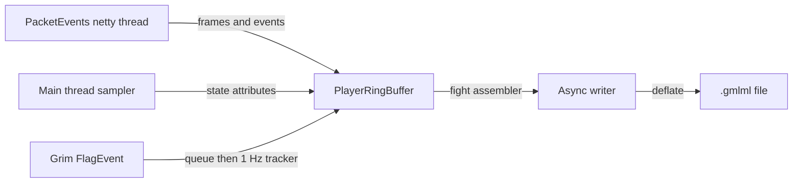

# grimml
   

A Paper plugin that records anonymized PvP combat data next to [Grim Anticheat](https://github.com/GrimAnticheat/Grim), to build a dataset for machine-learning cheat detection.

## Why

Rule-based anticheats like Grim are good at catching movement and protocol cheats. Combat cheats such as aim assist and subtle killaura are harder to pin down with fixed rules. A model trained on real fights could catch them, but that first needs clean, labelled combat data. grimml collects that data on a live server without hurting performance.

**In scope today:** GML3 combat recorder, staff **mark** segments, weak Grim-evidence sidecars, ban backfill labels. **Out of scope:** no ML inference, no staff alerts, no punishments (see [TODO.md](TODO.md) for training/inference repos).

## Features

- **Combat windows** with rolling pre/post buffer (configurable). Optional **`recording-mode: mark-only`** so windows flush only while `/grimml mark` is open (packets still buffer).
- **GML3 capture:** per-tick frames (position, rotation, input flags, ping, ack tick), fight-linked attacker/target/bystander snapshots, attacks with target anon ids, damage, swings, use-item, inventory/window, shield/totem/knockback, block place, setbacks, markers, and more.
- **Staff labeling:** `taxonomy.yml` defines clients/modules/settings; `/grimml mark start` writes time-range MARKER records with optional `client-name=meteor` (or any free text) plus module settings.
- **Live mark feedback:** marked players see an action bar with label/module/client name and data-quality hints (ping, jitter, mspt, frame count).
- **Weak labels from Grim:** bounded queue off the netty thread, decaying scores, `grim-labels.csv` / `grim-review.csv`, `/grimml suspects` and `/grimml review` (never `CHEAT_CONFIRMED` from Grim alone).
- **Ban hooks:** LiteBans (when installed) and vanilla kick fallback → SUSPECT backfill; grimml loads without LiteBans present.
- **Anonymized:** SHA-256 salted player ids, random session ids; sidecars use anon ids only.
- **Performance:** seqlock rings, single async writer, drop-newest under load, MSPT and disk-cap auto-pause.

Sibling repo **grimml-synth** (Python) generates synthetic pretraining windows. The **training/** folder in this repo holds the decode → train pipeline (`TODOtraining.md`).

## Requirements

| | |
|---|---|
| Server | Paper (or a fork such as Leaf), 1.21.1 through 26.x |
| Java | 21+ |
| Required plugin | [PacketEvents](https://github.com/retrooper/packetevents) 2.14.0+ |
| Optional plugins | GrimAC (weak labels), Geyser-Spigot / floodgate (Bedrock), LiteBans (ban backfill) |

## Installation

There are no release builds yet, so build it yourself (needs JDK 21+ and Maven):

```bash
git clone https://github.com/vanillaxtra/grimml
cd grimml
mvn clean package
```

1. Copy `target/grimml-0.1.0-SNAPSHOT.jar` and PacketEvents into `plugins/`.
2. Start the server once to generate `plugins/grimml/config.yml`, `taxonomy.yml`, `grim-weights.yml`.
3. **Change `anonymize-salt`** to a random secret value, then run `/grimml reload` or restart.

Recordings are written to `plugins/grimml/recordings/`.

## Usage

All commands need `grimml.admin` (op by default). Console/RCON supported where noted.

| Command | What it does |
|---|---|
| `/grimml status` | enabled/paused, windows written/dropped, bytes, drop summary |
| `/grimml pause` / `resume` | stop or resume flushing windows |
| `/grimml reload` | reload config, taxonomy, grim-weights; applies `recording-mode` to online sessions |
| `/grimml mark start <account> <label> [client] [module] [key=value...]` | open a labeled segment (`LEGIT_CONFIRMED` or `CHEAT`); e.g. `client-name=prestige strength=high` |
| `/grimml mark end <account>` | close the open segment |
| `/grimml testaccount [account] [on\|off]` | persist test-account UUIDs (excluded from normal player mixes in headers) |
| `/grimml suspects [limit]` | top decaying Grim-evidence scores (anon ids) |
| `/grimml review next` | next window flagged for staff replay |
| `/grimml review mark <id> confirmed\|legit\|unsure` | update review sidecar |

## Configuration (high level)

| Key | Default | Meaning |
|---|---|---|
| `enabled` | `true` | master switch |
| `recording-mode` | `auto` | `mark-only` = flush windows only during an open mark segment |
| `anonymize-salt` | `change-me` | player id hashing salt |
| `pre-combat-seconds` / `post-combat-seconds` | `5` / `2` | combat window timing |
| `ring-capacity` / `event-ring-capacity` | `160` / `128` | per-player buffers |
| `grim-evidence.enabled` | `true` | weak auto-labeling kill switch |
| `ban-labels.enabled` | `true` | combat ban → SUSPECT backfill |

See `config.yml` and [docs/architecture.md](docs/architecture.md) for the full list.

## Output format

Each combat window is one file: `<date>_<anonId>_<session>_<rand>.gmlml` with magic **`GML3`** (schema 3). Older `GML1`/`GML2` files remain identifiable by magic; they are not rewritten.

- **Header:** fight/window ids, role, trigger, label source, validity, session/anon ids, epoch + nanos, boot id, MSPT, ping, kit/server/map/world, MC/Grim/PacketEvents versions, taxonomy version + hash.
- **Body:** Deflate-compressed delta-encoded frames plus typed events (including MARKER / MARKER_KV).
- **Sidecars:** `sessions.idx` (join/quit/mark/grim lines), `grim-labels.csv`, `grim-review.csv`, `grim-checks.json`, `test-accounts.txt`.

Encoder: `format/BinaryFormat.java`. Round-trip check: `format/BinaryFormatSelfCheck.java`.

## How it works



More detail: [docs/architecture.md](docs/architecture.md), [docs/decisions.md](docs/decisions.md), progress [TODO.md](TODO.md).

## Non-goals (this repo)

- No trained model, ONNX inference, alerts, or punishments.
- No Folia-aware schedulers yet (Paper single-region scheduler).
- Full training/inference automation lives under **`training/`** (see `training/TODOtraining.md`); alert-only server plugin is still out of scope.

Open bugs and quirks: [docs/known-issues.md](docs/known-issues.md).

## Contributing

```bash
mvn clean package               # build + binary format self-check
mvn clean package -DskipTests   # build only
```

- One folder per function, one file per feature.
- Keep the packet path free of allocations and locks on the hot path.
- Update `docs/` and [TODO.md](TODO.md) when behaviour changes.

## License

[MIT](LICENSE)
