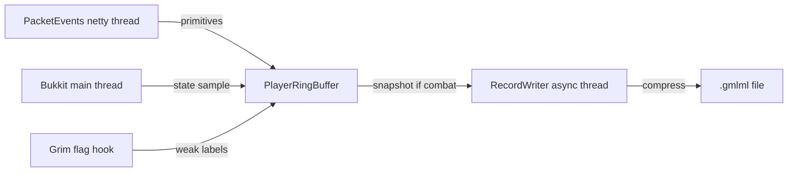

# grimml - architecture

- **target:** Paper 1.21.1 through 26.x, Java 21 bytecode, Maven
- **packet capture:** PacketEvents 2.14.0
- **soft-depends:** GrimAC, Geyser-Spigot, floodgate, ViaVersion, ProtocolLib

## structure
one folder per function, one file per feature

- `src/main/java/dev/grimml/GrimMLPlugin.java` - bootstrap and wiring
- `config/PluginConfig.java` - typed config loader
- `capture/PacketListener.java` - single PacketEvents listener, dispatch only
- `capture/RotationCapture.java` - rotation + position/rotation packets
- `capture/AttackCapture.java` - attack packets, opens combat window
- `state/StateSampler.java` - main thread heartbeat: ping + sprint/sneak/vehicle/elytra/Bedrock flags, flush, safety valves
- `state/SessionLifecycle.java` - join/quit buffers, client brand + protocol
- `state/SprintSneakTracker.java` - sprint/sneak toggle events
- `safety/MsptGuard.java` - auto-pause on high MSPT
- `safety/DiskCapGuard.java` - auto-pause over disk cap
- `grim/GrimFlagHook.java` - weak labels from Grim flags
- `geyser/GeyserHook.java` - reflection-based Bedrock/Floodgate detection
- `buffer/PlayerRingBuffer.java` - per-player preallocated rotation + event rings
- `buffer/CombatSnapshot.java` - reusable drain buffer for the writer
- `buffer/SessionRegistry.java` - uuid to ring buffer map
- `format/BinaryFormat.java` - compressed `.gmlml` window encoder
- `format/RecordTypes.java` - record type tags + state flag bits
- `format/BinaryFormatSelfCheck.java` - encoder round-trip check (`mvn exec:java`)
- `writer/RecordWriter.java` - single async writer thread with bounded queue
- `writer/SnapshotPool.java` - pooled snapshots
- `writer/RecordingFiles.java` - recordings dir + `.gmlml` file naming
- `privacy/Anonymizer.java` - salted UUID hashing + session ids
- `commands/GrimMLCommand.java` - /grimml router + tab complete
- `commands/StatusCommand.java`, `PauseCommand.java`, `ResumeCommand.java`, `ReloadCommand.java` - one per subcommand

## data flow

## commands & permissions

| command | permission | notes |
|---|---|---|
| `/grimml status` | `grimml.admin` | written/dropped windows, bytes, paused state |
| `/grimml pause` | `grimml.admin` | stop flushing new snapshots |
| `/grimml resume` | `grimml.admin` | resume flushing |
| `/grimml reload` | `grimml.admin` | reload config from disk |
