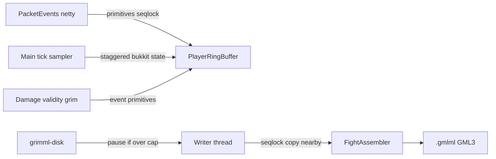

# grimml - architecture

- **target:** Paper 1.21.1 through 26.x, Java 21 bytecode, Maven
- **packet capture:** PacketEvents 2.14.0
- **schema:** GML3 (schema 3); GML1/GML2 files stay identifiable by magic, not rewritten
- **depends:** packetevents (hard, used directly at enable)
- **soft-depends:** GrimAC, Geyser-Spigot, floodgate, LiteBans
- **commands:** `/grimml` registered via Paper lifecycle `LifecycleEvents.COMMANDS` as a `BasicCommand`; plugin.yml has no `commands:` section
- **config schema version:** 3

## structure
one folder per function, one file per feature

- `clock/TickClock.java` - main-thread tick, duration, boot id, epoch pairing
- `buffer/FrameRing.java` - seqlock per-tick frames
- `buffer/EventRing.java` - seqlock events
- `buffer/InventoryMirror.java` - player inv 0-45 from set-slot packets
- `buffer/EntityIndex.java` - entityId to anonId
- `buffer/PlayerRingBuffer.java` - live state plus rings
- `buffer/SessionRegistry.java` - uuid map
- `buffer/CombatSnapshot.java` - pooled copy for the writer
- `fight/FightAssembler.java` - writer-thread attacker/target/bystander snapshots
- `capture/` - PacketEvents handlers (flying, input, attack, held, inventory, actions, outgoing)
- `listeners/DamageListener.java`, `listeners/ValidityListener.java`
- `item/ItemCategories.java`, `item/ItemUtil.java`
- `format/BinaryFormat.java` - GML3 encoder
- `writer/RecordWriter.java` - async drain, session sidecar
- `taxonomy/` - `taxonomy.yml` clients, modules, setting schemas, stable ids, file hash
- `grim/GrimCheckCatalog.java` - FlagEvent check names persisted to `grim-checks.json`
- `mark/` - open segments, marker kv events, `test-accounts.txt`
- `commands/` - status, pause, resume, reload, mark, testaccount
- `roster/` - combat-reason matcher, append-only `roster.csv`, ban label service
- `hooks/LiteBansHook.java` - combat bans become SUSPECT with a 14-day backfill
- `listeners/VanillaBanListener.java` - vanilla `/ban` kick fallback

## data flow

## commands & permissions

| command | permission | notes |
|---|---|---|
| `/grimml status` | `grimml.admin` | windows, drops, bytes |
| `/grimml pause` | `grimml.admin` | stop flushing |
| `/grimml resume` | `grimml.admin` | resume flushing |
| `/grimml reload` | `grimml.admin` | reload config and `taxonomy.yml` |
| `/grimml mark start <account> <label> [client] [module] [key=value...]` | `grimml.admin` | time-range MARKER; console/RCON; labels `LEGIT_CONFIRMED` or `CHEAT` |
| `/grimml mark end <account>` | `grimml.admin` | close the open segment |
| `/grimml testaccount [account] [on\|off]` | `grimml.admin` | persist test-account uuids; header flag so they never mix with normal players |
