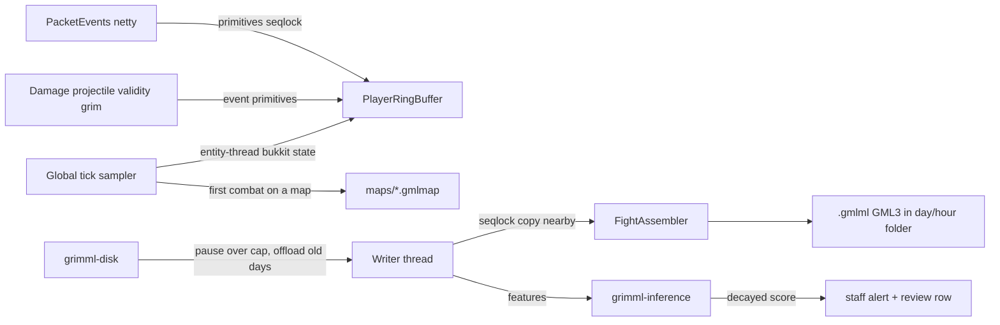

# grimml - architecture

- **target:** Paper 1.21.1 through 26.x, Folia, Java 21 bytecode, Maven
- **packet capture:** PacketEvents 2.14.0
- **schema:** GML3 (schema 3); GML1/GML2 files stay identifiable by magic, not rewritten. record types 27-30 (enchant, combat detail, retotem, jump reset) reuse the generic event layout, so no schema bump
- **depends:** packetevents (hard, used directly at enable)
- **soft-depends:** GrimAC, Geyser-Spigot, floodgate, LiteBans
- **commands:** `/grimml` registered via Paper lifecycle `LifecycleEvents.COMMANDS` as a `BasicCommand`; plugin.yml has no `commands:` section
- **config schema version:** 5

## structure
one folder per function, one file per feature

- `clock/TickClock.java` - global tick, duration, boot id, epoch pairing; own counter on Folia
- `scheduler/Tasks.java` - Paper global/region/async/entity schedulers (same code on Paper and Folia)
- `buffer/FrameRing.java` - seqlock per-tick frames
- `buffer/EventRing.java` - seqlock events
- `buffer/InventoryMirror.java` - player inv 0-45 from set-slot packets and window-0 click changes, with packed enchants
- `buffer/EntityIndex.java` - entityId to anonId
- `buffer/PlayerRingBuffer.java` - live state plus rings; jump-reset history bits, retotem timer, per-bit validity timestamps
- `buffer/SessionRegistry.java` - uuid map
- `buffer/CombatSnapshot.java` - pooled copy for the writer
- `fight/FightAssembler.java` - writer-thread attacker/target/bystander snapshots; per-window validity; appends the ENCHANT record; mark-only skips everyone except the open mark
- `capture/` - PacketEvents handlers (flying, input, attack, held, inventory, actions, outgoing)
- `listeners/DamageListener.java` (+ mace smash / spear hit detail), `listeners/ProjectileListener.java`, `listeners/ValidityListener.java`
- `item/ItemCategories.java`, `item/ItemUtil.java`, `item/EnchantPacker.java`
- `format/BinaryFormat.java` - GML3 encoder
- `writer/RecordWriter.java` - async drain, session sidecar, hands finished windows to inference
- `writer/RecordingFiles.java` - `rotation` sub folders (`<day>/<hour>/`)
- `storage/Offloader.java` - moves finished day folders to `offload.dir` on the disk thread
- `maps/` - `MapSnapshotter` (region-thread chunk snapshots, 4 chunks per tick), `MapFileWriter` (GMM1), `MapRegion`
- `inference/` - `FeatureExtractor` (java mirror of `extract.py`), `LgbmModel` (lightgbm text tree walker), `ModelBundle`, `InferenceService` (`grimml-inference` thread), `ViolationBuffer`, `AlertNotifier`
- `taxonomy/` - `taxonomy.yml` clients, modules, setting schemas, stable ids, file hash
- `grim/GrimCheckCatalog.java` - FlagEvent check names persisted to `grim-checks.json`
- `grim/GrimEvidenceTracker.java` - 1 Hz weak labels; FlagEvent copies primitives into `FlagQueue`
- `grim/EvidenceStore.java` - `grim-labels.csv`, `grim-review.csv` (model alerts land here as `MODEL_ALERT`)
- `mark/` - open segments, marker kv events, `test-accounts.txt`, staff `marks.csv` ledger, action bar for player and operator
- `commands/` - status, pause, resume, reload, mode, mark, testaccount, suspects, review, mapsave
- `roster/` - combat-reason matcher, append-only `roster.csv`, ban label service
- `hooks/LiteBansHook.java` - combat bans become SUSPECT with a 14-day backfill
- `hooks/LiteBansBridge.java` - loads the hook only when LiteBans and its api class are present
- `listeners/VanillaBanListener.java` - vanilla `/ban` kick fallback

## data flow

## commands & permissions

| command | permission | notes |
|---|---|---|
| `/grimml status` | `grimml.admin` | windows, drops (records by type), bytes, inference latency |
| `/grimml pause` | `grimml.admin` | stop flushing |
| `/grimml resume` | `grimml.admin` | resume flushing |
| `/grimml reload` | `grimml.admin` | reload config, `taxonomy.yml`, `grim-weights.yml`, model |
| `/grimml mode markonly on\|off` | `grimml.admin` | runtime recording-mode switch until reload/restart |
| `/grimml mark start <account> <label> [client] [module] [key=value...]` | `grimml.admin` | time-range MARKER; prints id `m########`; console/RCON; labels `LEGIT_CONFIRMED` or `CHEAT` |
| `/grimml mark end <account>` | `grimml.admin` | close the open segment; repeats id + duration |
| `/grimml mark list` | `grimml.admin` | open marks plus recent ids from `marks.csv` |
| `/grimml mark get <id>` | `grimml.admin` | one mark: settings, duration, file count (today and yesterday) |
| `/grimml testaccount [account] [on\|off]` | `grimml.admin` | persist test-account uuids; header flag so they never mix with normal players |
| `/grimml suspects [limit]` | `grimml.admin` | top decaying grim scores, anon ids only |
| `/grimml review next` | `grimml.admin` | next `GRIM_WEAK` or `MODEL_ALERT` row for staff replay |
| `/grimml review mark <id> confirmed\|legit\|unsure` | `grimml.admin` | writes `replay-confirmed` / legit; never overwrites staff markers |
| `/grimml mapsave` | `grimml.admin` | force a map snapshot around the player |
| model alerts | `grimml.alerts` | chat alert with player name; disk keeps anon ids only |
