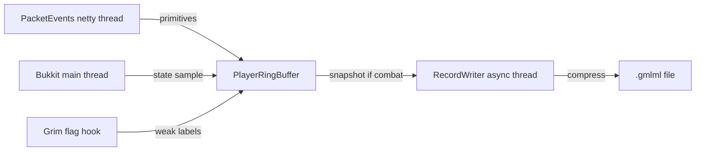

# grimml - architecture

- **target:** Paper 1.21.1 through 26.x, Java 21 bytecode, Maven
- **packet capture:** PacketEvents 2.14.0
- **soft-depends:** GrimAC, Geyser-Spigot, floodgate, ViaVersion, ProtocolLib

## structure
- `src/main/java/dev/grimml/GrimMLPlugin.java` - bootstrap, config, safety valves
- `configs/PluginConfig.java` - typed config loader
- `hooks/PacketListener.java` - PacketEvents movement + attack capture
- `hooks/GrimFlagHook.java` - weak labels from Grim flags
- `hooks/GeyserHook.java` - reflection-based Bedrock/Floodgate detection
- `listeners/StateMetadataListener.java` - ping, sprint/sneak/vehicle/elytra, Bedrock flags
- `record/PlayerRingBuffer.java` - per-player preallocated rotation + event rings
- `record/CombatSnapshot.java` - reusable drain buffer for the writer
- `record/BinaryFormat.java` - compressed `.gmlml` window encoder
- `record/RecordWriter.java` - single async writer thread with bounded queue
- `record/Anonymizer.java` - salted UUID hashing + session ids
- `commands/GrimMLCommand.java` - /grimml status/pause/resume/reload

## data flow

## commands & permissions

| command | permission | notes |
|---|---|---|
| `/grimml status` | `grimml.admin` | written/dropped windows, bytes, paused state |
| `/grimml pause` | `grimml.admin` | stop flushing new snapshots |
| `/grimml resume` | `grimml.admin` | resume flushing |
| `/grimml reload` | `grimml.admin` | reload config from disk |
