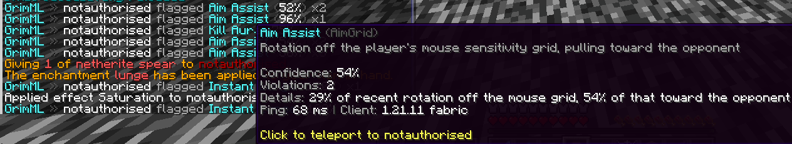

# 🔔 Alerts

* **One short line** – `GrimML » Steve flagged Kill Aura (74%) x2`
* **Confidence %** – ML checks: the model's average cheat score over the fight. Rule checks: the share of recent
  swaps or hits that matched the cheat's pattern.
* **Hover for details** – check, description, violations, what was measured, ping and client.
* **Click to teleport** – runs `/tp %player%` by default (any command).
* **Sound ping** – for staff with `grimml.alerts.sound`.
* **Toggle** – `/grimml alerts`.
* **Grim-friendly** – fires Grim's `FlagEvent`, so other Grim add-ons see and can cancel GrimML flags.

<!-- IMAGE: alerts - hovering over an alert, then clicking it to teleport -->

---

# 📖 In-depth explanation

> ✏️ **Write-up space.** Everything above is the quick reference. Fill in the sections below with the full story of
> this feature; delete any heading you do not need. HTML comments (`<!-- -->`) are hidden on the rendered page.

### 🎯 How the cheat works

<!-- What the cheat does on the client, which clients ship it, which settings matter (delays, FOV, smoothing...). -->

### 🔬 What GrimML measures

<!-- The signal: which packets, which features, which numbers. Diagrams / screenshots welcome. -->

### ✅ Why legit players do not flag

<!-- What separates a strong legit player from the cheat. Recorded legit data, edge cases you tested. -->

### ⚠️ Known false flags and limits

<!-- Situations that can flag a legit player, cheat settings that slip through, client versions skipped. -->

### 🛠️ Tuning for your server

<!-- Which config values to change for a stricter / looser server, and what each change costs. -->

### 🖼️ Example alerts

<!-- Paste a real alert line, hover text or webhook embed, plus a GIF if you have one. -->

<!-- IMAGE: example-<check> -->

### 📝 Notes and history

<!-- Changes between versions, ideas, things still UNVERIFIED. -->

---

[🏠 Home](Home) · [🧠 All Checks](Checks) · [⚙️ Configuration](Configuration)
