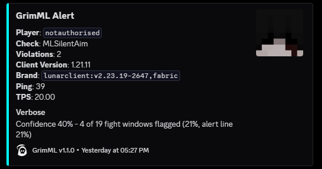

# 💬 Discord Webhook

* Laid out **exactly like Grim's own webhook**, so GrimML alerts sit neatly next to Grim's.
* Uses **Grim's webhook URL** automatically (`use-grim-webhook: true`), or set `webhook.url`.
* **Punishments are posted too** – a red *GrimML Punishment* embed with the player, the punishment and the commands
  that ran.

<!-- IMAGE: webhook - an alert embed and a punishment embed in Discord -->

---

# 📖 In-depth explanation

> ✏️ **Write-up space.** Everything above is the quick reference. Fill in the sections below with the full story of
> this feature; delete any heading you do not need. HTML comments (`<!-- -->`) are hidden on the rendered page.

### 🎯 How the cheat works

<!-- What the cheat does on the client, which clients ship it, which settings matter (delays, FOV, smoothing...). -->

### 🔬 What GrimML measures

<!-- The signal: which packets, which features, which numbers. Diagrams / screenshots welcome. -->

### ✅ Why legit players do not flag

<!-- What separates a strong legit player from the cheat. Recorded legit data, edge cases you tested. -->

### ⚠️ Known false flags and limits

<!-- Situations that can flag a legit player, cheat settings that slip through, client versions skipped. -->

### 🛠️ Tuning for your server

<!-- Which config values to change for a stricter / looser server, and what each change costs. -->

### 🖼️ Example alerts

<!-- Paste a real alert line, hover text or webhook embed, plus a GIF if you have one. -->

<!-- IMAGE: example-<check> -->

### 📝 Notes and history

<!-- Changes between versions, ideas, things still UNVERIFIED. -->

---

[🏠 Home](Home) · [🧠 All Checks](Checks) · [⚙️ Configuration](Configuration)
