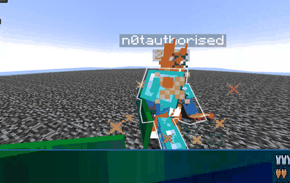

# ⚔️ Kill Aura

  

**Automatic attacking and aiming at whoever is in reach.**

<!-- GIF: killaura - a Kill Aura player getting flagged, chat alert visible -->


---

# 📋 At a Glance

| | |
|---|---|
| **Check name** | `MLKillAura` |
| **Type** | Machine-learning model |
| **Default** | On |
| **Clients** | All |
| **Bypass** | `grimml.bypass.mlkillaura` |
| **Config section** | `scan, models` |

---

# 🔍 What It Detects

* Locks rotation onto the nearest target and attacks on its own.
* Judged over the whole fight, so one lucky flick never flags anyone.
* Scored every 2 s on the last 8 s of aim and clicks. A **fight** flags when its share of flagged windows reaches the model's alert line (see [How Scoring Works](How-Scoring-Works)).

---

# 📊 Tested Against

| Measure | Value |
|---------|-------|
| Alert line (`alert_share`) | 0.28 |
| Held-out AUC | 0.802 |
| Cheat sessions caught | 7 / 8 |

<sub>Source: manifest v10. Numbers change as models and data are updated.</sub>

---

# ⚙️ Configuration

```yaml
scan:
  interval-ms: 2000
  min-attacks: 2
  fight-block-windows: 120
  fight-min-windows: 20
  early-alert-z: 3.0
  early-alert-min-windows: 10
```

---

# 📖 In-depth explanation

> ✏️ **Write-up space.** Everything above is the quick reference. Fill in the sections below with the full story of
> this check; delete any heading you do not need. HTML comments (`<!-- -->`) are hidden on the rendered page.

### 🎯 How the cheat works

<!-- What the cheat does on the client, which clients ship it, which settings matter (delays, FOV, smoothing...). -->

### 🔬 What GrimML measures

<!-- The signal: which packets, which features, which numbers. Diagrams / screenshots welcome. -->

### ✅ Why legit players do not flag

<!-- What separates a strong legit player from the cheat. Recorded legit data, edge cases you tested. -->

### ⚠️ Known false flags and limits

<!-- Situations that can flag a legit player, cheat settings that slip through, client versions skipped. -->

### 🛠️ Tuning for your server

<!-- Which config values to change for a stricter / looser server, and what each change costs. -->

### 🖼️ Example alerts

<!-- Paste a real alert line, hover text or webhook embed, plus a GIF if you have one. -->

<!-- IMAGE: example-<check> -->

### 📝 Notes and history

<!-- Changes between versions, ideas, things still UNVERIFIED. -->

---

[🏠 Home](Home) · [🧠 All Checks](Checks) · [⚙️ Configuration](Configuration)
