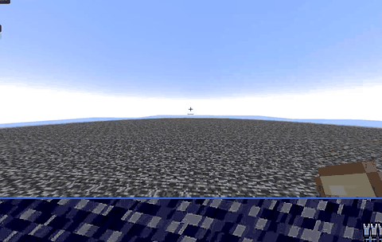

# 🔱 Instant Lunge (LungeRate)

  

**Swap-lunges chained faster than a hand can.**

<!-- GIF: lunge - Instant Lunge macro getting flagged -->


---

# 📋 At a Glance

| | |
|---|---|
| **Check name** | `LungeRate` |
| **Type** | Rule check (no model, exact) |
| **Default** | On |
| **Clients** | All |
| **Bypass** | `grimml.bypass.lungerate` |
| **Config section** | `lunge-rate` |

---

# 🔍 What It Detects

* A **swap-lunge** is a spear jab within 150 ms of a hotbar swap to the spear.
* Counts gaps between swap-lunges in `[min-ms, fast-ms)`.
* Jabbing while already holding the spear never counts.
* Runs on every player, not only attackers, because a lunge-only player never sends an attack.

---

# 📊 Tested Against

| Measure | Value |
|---------|-------|
| Fastest legit gap | 345 ms |
| Instant Lunge gaps | 100–250 ms |
| Cheat sessions caught | 7 / 7 |

<sub>Source: recorded fights replayed. Numbers change as models and data are updated.</sub>

---

# ⚙️ Configuration

```yaml
lunge-rate:
  enabled: true
  fast-ms: 300
  min-ms: 75
  count: 6
  window-ms: 30000
  alert-cooldown-ms: 15000
```

---

# 📖 In-depth explanation

> ✏️ **Write-up space.** Everything above is the quick reference. Fill in the sections below with the full story of
> this check; delete any heading you do not need. HTML comments (`<!-- -->`) are hidden on the rendered page.

### 🎯 How the cheat works

<!-- What the cheat does on the client, which clients ship it, which settings matter (delays, FOV, smoothing...). -->

### 🔬 What GrimML measures

<!-- The signal: which packets, which features, which numbers. Diagrams / screenshots welcome. -->

### ✅ Why legit players do not flag

<!-- What separates a strong legit player from the cheat. Recorded legit data, edge cases you tested. -->

### ⚠️ Known false flags and limits

<!-- Situations that can flag a legit player, cheat settings that slip through, client versions skipped. -->

### 🛠️ Tuning for your server

<!-- Which config values to change for a stricter / looser server, and what each change costs. -->

### 🖼️ Example alerts

<!-- Paste a real alert line, hover text or webhook embed, plus a GIF if you have one. -->

<!-- IMAGE: example-<check> -->

### 📝 Notes and history

<!-- Changes between versions, ideas, things still UNVERIFIED. -->

---

[🏠 Home](Home) · [🧠 All Checks](Checks) · [⚙️ Configuration](Configuration)
